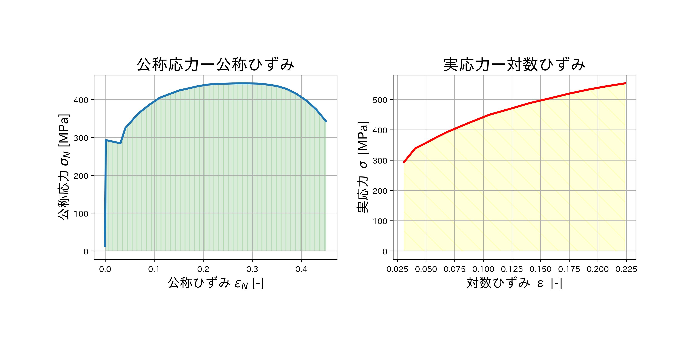

<div align="center">


# ⚙️ Pythonで学ぶ機械工学

**機械工学の計算を、そのまま動かせるノートブックにまとめました。**<br>
静力学 · 材料力学 · 熱力学 · 振動 · 数値計算<br>
<sub>ラベルは日本語と英語の併記です</sub>

<br>

<a href="https://github.com/aimanamri/mechanicalEngineering"></a>
<a href="https://github.com/aimanamri/mechanicalEngineering/commits/main"></a>
<a href="https://github.com/aimanamri/mechanicalEngineering/stargazers"></a>


<br><br>

🌐 [English](README.md) · **日本語**

**目次：**
[🚀 クイックスタート](#-クイックスタート) ·
[🏗️ 材料力学](#%EF%B8%8F-材料力学) ·
[♨️ 熱力学](#%EF%B8%8F-熱力学) ·
[🎯 力学・振動](#-力学振動) ·
[🧮 工学数学](#-工学数学) ·
[🎨 クレジット](#-クレジット)

</div>

<br>

> **このページの見方** 各トピックには、物理現象をイメージしやすいループ再生のドット絵アニメーションを付けています。あわせて、ひとこと説明、ノートブックやスクリプトへのリンク、実際の出力を収めた折りたたみ式の「📈 グラフを見る」を用意しました。GIFをクリックすると、元のファイルが開きます。

---

## 🚀 クイックスタート

```bash
git clone https://github.com/aimanamri/mechanicalEngineering.git -b main
cd mechanicalEngineering
python3 -m venv venv
source venv/bin/activate        # Windowsの場合: venv\Scripts\activate
pip install -r requirements.txt jupyter
jupyter lab
```

好きな `.ipynb` を開いて **Run All**（すべて実行）を選んでください。単体のスクリプトは、`python3 mohr_circle.py` のようにそのまま実行できます。

<details>
<summary><b>📋 動作環境と使用ライブラリ</b></summary>

<br>

**Python 3.12以上が必要です。** `requirements.txt` は NumPy 2.x / SciPy 1.18 に固定されており、これらは Python 3.12以上を必要とします（3.13で動作確認済み）。ほかのプロジェクトとバージョンが衝突しないよう、仮想環境の利用をおすすめします。

| ライブラリ | 用途 |
|---|---|
| `numpy`, `scipy` | 配列計算、補間、数値積分、線形代数、常微分方程式の求解 |
| `matplotlib` | すべてのグラフ（SFD/BMD、モールの応力円、応力-ひずみ線図、T-s線図、p-h線図など） |
| `japanize_matplotlib` | グラフの日本語ラベル・タイトルを表示 |
| `pandas`, `openpyxl` | 引張試験ノートブックでの `practice.xlsx` の読み込みと処理 |
| `pyromat` | 水蒸気と R-134a の物性値。デフォルトのbarではなく、**SI組立単位（MPa, K, kJ/kg）** で出力するよう設定 |
| `rich` | 熱力学ノートブックで結果を見やすい表として表示 |
| `setuptools` | Python 3.12以上で `japanize_matplotlib` が必要とする `distutils` の互換機能を提供 |

**そのほかの実行方法**

- **VS Code：** フォルダを開き、Jupyter拡張機能で `venv` のカーネルを選択します。
- **コマンドラインで全出力を再生成：**
  ```bash
  jupyter nbconvert --to notebook --execute --inplace *.ipynb
  ```

</details>

---

## 🏗️ 材料力学

<table>
<tr>
<td width="260" align="center" valign="top">
<a href="mohr_circle.py"></a>
</td>
<td valign="top">

### モールの応力円
*Mohr's Circle*

二次元の応力状態（σx, σy, τxy）をモールの応力円として描きます。

[](mohr_circle.py)

<details>
<summary>📈 グラフを見る</summary>
<br>

</details>

</td>
</tr>
<tr>
<td width="260" align="center" valign="top">
<a href="SFD-BMD.ipynb"></a>
</td>
<td valign="top">

### せん断力図・曲げモーメント図
*Shear Force / Bending Moment Diagrams (SFD / BMD)*

荷重を受けるはりについて、せん断力と曲げモーメントの分布を求めます。

[](SFD-BMD.ipynb)

<details>
<summary>📈 グラフを見る</summary>
<br>

</details>

</td>
</tr>
<tr>
<td width="260" align="center" valign="top">
<a href="tensile-test.ipynb"></a>
</td>
<td valign="top">

### 引張試験
*Tensile Test*

`practice.xlsx` の試験データから、応力-ひずみ線図を描きます。

[](tensile-test.ipynb)
[](practice.xlsx)

<details>
<summary>📈 グラフを見る</summary>
<br>

</details>

</td>
</tr>
<tr>
<td width="260" align="center" valign="top">
<a href="vonmises-failure_plot.ipynb"></a>
</td>
<td valign="top">

### ミーゼスの破損説
*von Mises Failure Theory*

延性材料が安全でなくなる境界、つまり降伏の限界を、主応力平面上に描きます。

[](vonmises-failure_plot.ipynb)

<details>
<summary>📈 グラフを見る</summary>
<br>

</details>

</td>
</tr>
</table>

---

## ♨️ 熱力学

<table>
<tr>
<td width="260" align="center" valign="top">
<a href="rankine_cycle.ipynb"></a>
</td>
<td valign="top">

### 理想ランキンサイクルの熱効率
*Ideal Rankine Cycle*

基本的な蒸気サイクルの熱効率 η を、`pyromat` の水蒸気物性値から求めます。

[](rankine_cycle.ipynb)

</td>
</tr>
<tr>
<td width="260" align="center" valign="top">
<a href="rankine_reheat_cycle.ipynb"></a>
</td>
<td valign="top">

### 再熱ランキンサイクルの熱効率
*Rankine Reheat Cycle*

タービンの段の間で蒸気を再加熱するサイクルです。タービン出口の湿り度（乾き度）も確認できます。

[](rankine_reheat_cycle.ipynb)

</td>
</tr>
<tr>
<td width="260" align="center" valign="top">
<a href="refrigeration_cycle.ipynb"></a>
</td>
<td valign="top">

### 理想冷凍サイクルの成績係数（COP）
*Ideal Refrigeration Cycle*

R-134a を用いた蒸気圧縮冷凍サイクルの成績係数を、p-h線図とあわせて求めます。

[](refrigeration_cycle.ipynb)

</td>
</tr>
</table>

---

## 🎯 力学・振動

<table>
<tr>
<td width="260" align="center" valign="top">
<a href="projectile_motion.ipynb"></a>
</td>
<td valign="top">

### 斜方投射
*Projectile Motion*

投射角と初速を変えたときの、軌道・到達距離・最高点を求めます。

[](projectile_motion.ipynb)
[](projection_motion.py)

<details>
<summary>📈 グラフを見る</summary>
<br>

</details>

</td>
</tr>
<tr>
<td width="260" align="center" valign="top">
<a href="damped_vibration.ipynb"></a>
</td>
<td valign="top">

### 減衰振動（不足減衰・過減衰）
*Damped Vibration*

不足減衰と過減衰、2つの場合の振動の応答を並べて比べます。

[](damped_vibration.ipynb)

</td>
</tr>
<tr>
<td width="260" align="center" valign="top">
<a href="numerical_kinematics.ipynb"></a>
</td>
<td valign="top">

### 数値解析による力・速度・加速度の計算
*Numerical Force, Velocity & Acceleration*

オイラー法、台形公式、シンプソン則を運動のデータに適用します。

[](numerical_kinematics.ipynb)

</td>
</tr>
</table>

---

## 🧮 工学数学

<table>
<tr>
<td width="260" align="center" valign="top">
<a href="math.ipynb"></a>
</td>
<td valign="top">

### 1冊のノートブックに4つの道具
すべての計算を、1つのノートブックにまとめています。

[](math.ipynb)

- **線形補間**（Interpolation）
- **数値積分**：台形公式とシンプソン則
- **行列**の足し算・引き算・掛け算
- **固有値・固有ベクトル**

</td>
</tr>
</table>

---

## ✅ ステータス


上に挙げたトピックは、すべて完成しています。

---

## 🎨 クレジット

ドット絵アニメーションは **[Pixelbolt](https://github.com/skulitom/Pixelbolt)**（MITライセンス、写しは [`assets/pixelbolt/LICENSE`](assets/pixelbolt/LICENSE)）で作られたものです。各トピックのイメージを表すイラストであり、ノートブックの出力ではありません。最上部のバナーは、Pixelbolt の沸騰する鍋と蒸気の噴出口に歯車列を加えて組み立てた新しいシーンです。

コードとノートブックは、リポジトリの [LICENSE](LICENSE) のもとで公開しています。
