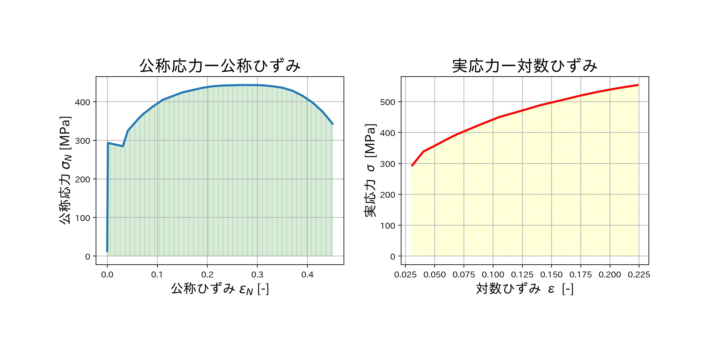

<p align="center">
  <a href="https://github.com/aimanamri/mechanicalEngineering">
    
  </a>

  <a href="https://github.com/aimanamri/mechanicalEngineering">
    
  </a>
  
  <a href="https://github.com/aimanamri/mechanicalEngineering/stargazers">
    
  </a>

  <a href="https://github.com/aimanamri/mechanicalEngineering/commits/main">
    
  </a>

  <a href="https://github.com/aimanamri/mechanicalEngineering">
    
  </a>
</p>

## ▶️ Getting Started

Starting with **git clone**:

```bash
git clone https://github.com/aimanamri/mechanicalEngineering.git -b main
cd mechanicalEngineering
```

## Pre-Requisites
- **Python 3.12 or later** - `requirements.txt` is pinned to NumPy 2.x/SciPy 1.18, which require Python ≥3.12 (tested on 3.13).
- A virtual environment is recommended so these pins don't collide with other projects:
```bash
python3 -m venv venv
source venv/bin/activate        # Windows: venv\Scripts\activate
```
- Install all packages in `requirements.txt` (everything the notebooks import) plus `jupyter` itself (which pulls in `ipykernel` automatically):
```bash
pip install -r requirements.txt jupyter
```

### Libraries used
| Library | Used for |
|---|---|
| `numpy`, `scipy` | numerical arrays, interpolation, integration, linear algebra, ODE solving |
| `matplotlib` | all plots (SFD/BMD, Mohr's circle, stress-strain curves, T-s/p-h diagrams, ...) |
| `japanize_matplotlib` | renders the Japanese (日本語) labels/titles used throughout |
| `pandas`, `openpyxl` | reading and processing `practice.xlsx` in the tensile-test notebook |
| `pyromat` | steam and R-134a refrigerant properties (Rankine, reheat, refrigeration cycle notebooks) - configured to output **SI-derived units (MPa, K, kJ/kg)** rather than its bar default |
| `rich` | nicely formatted result tables printed inside the thermodynamics notebooks |
| `setuptools` | provides the `distutils` shim `japanize_matplotlib` needs on Python 3.12+ (distutils was removed from the standard library) |

### Running the notebooks
- **Jupyter Notebook / JupyterLab**: `jupyter notebook` or `jupyter lab`, then open any `.ipynb` file and *Run All*.
- **VS Code**: open the folder and use the built-in Jupyter extension (select the `venv` kernel created above).
- **Headless / regenerate all outputs from the command line**:
```bash
jupyter nbconvert --to notebook --execute --inplace *.ipynb
```
- Standalone scripts (`mohr_circle.py`, `projection_motion.py`) run directly with `python3 <script>.py`.

---

# 💻 Mechanical Engineering Calculations
+ [x] Projectile motion (斜方投射) <br>
[projectile_motion.ipynb](https://github.com/aimanamri/mechanicalEngineering/blob/main/projectile_motion.ipynb)<br>
[projectile_motion.py](https://github.com/aimanamri/mechanicalEngineering/blob/main/projection_motion.py)<br>


+ [x] von Mises Failure Theory Plots <br>
[vonmises-failure_plot.ipynb](https://github.com/aimanamri/mechanicalEngineering/blob/main/vonmises-failure_plot.ipynb)


+ [x] Shear Force Diagram,SFD and Bending Moment Diagram,BMD (せん断力図・曲げモーメント図) <br>
[SFD-BMD.ipynb](https://github.com/aimanamri/mechanicalEngineering/blob/main/SFD-BMD.ipynb)


+ [x] Mohr's Circle (モールの応力円)<br>
[mohr_circle.py](https://github.com/aimanamri/mechanicalEngineering/blob/main/mohr_circle.py)


+ [x] Tensile Test (引張試験)<br>
- [tensile-test.ipynb](https://github.com/aimanamri/mechanicalEngineering/blob/main/tensile-test.ipynb)
- Data Source: [practice.xlsx](https://github.com/aimanamri/mechanicalEngineering/blob/main/practice.xlsx)


+ [x] Heat effieciency, η of ideal Rankine cycle (理想ランキンサイクルの熱効率)<br>
[rankine_cycle.ipynb](https://github.com/aimanamri/mechanicalEngineering/blob/main/rankine_cycle.ipynb)

+ [x] Heat effieciency, η of  Rankine reheat cycle (理想ランキンサイクルの熱効率)<br>
[rankine_reheat_cycle.ipynb](https://github.com/aimanamri/mechanicalEngineering/blob/main/rankine_reheat_cycle.ipynb)

+ [x] Coefficient of performance(COF) of ideal refrigeration cycle　(冷凍サイクルの成績係数/動作係数)<br>
[refrigeration_cycle.ipynb](https://github.com/aimanamri/mechanicalEngineering/blob/main/refrigeration_cycle.ipynb)

+ [x] Under damping system/vibration (不足減衰)<br>
+ [x] Over damping system/vibration (過減衰)<br>
[damped_vibration.ipynb](https://github.com/aimanamri/mechanicalEngineering/blob/main/damped_vibration.ipynb)

+ [x] Numerical computation of Force, Velocity & Acceleration - Euler's method, Trapezoidal rule, Simpson's rule (数値解析による力・速度・加速度の計算)<br>
[numerical_kinematics.ipynb](https://github.com/aimanamri/mechanicalEngineering/blob/main/numerical_kinematics.ipynb)

---

# 💻 Engineering Math using Python 
📔 [math.ipynb](https://github.com/aimanamri/mechanicalEngineering/blob/main/math.ipynb) - All calculation was made in this single notebook.
+ [x] Interpolation (線形補間)

+ [x] Numerical intergration using trapezoidal rule and Simpson (数値積分：台形公式とシンプソン則)

+ [x] Addition, subtraction and multiplication of matrice (行列の足し算・引き算・掛け算)

+ [x] Eigenvector and eigenvalue (固有ベクトル・固有値)

## Project Status

* █████████████   Complete

---
