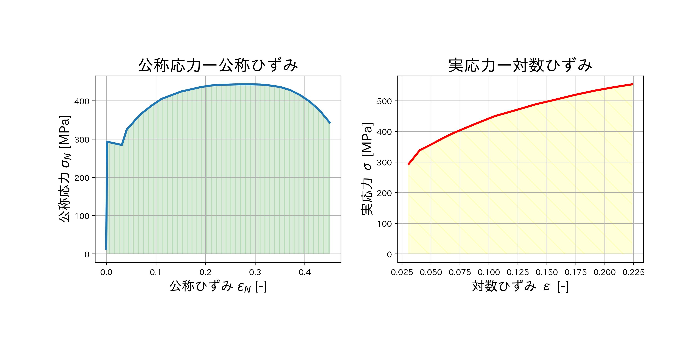

<div align="center">


# ⚙️ Mechanical Engineering in Python

**Worked calculations from a mechanical engineering degree, as runnable notebooks.**<br>
Statics · Strength of materials · Thermodynamics · Vibration · Numerical methods<br>
<sub>日本語ラベル付き · labels in English and 日本語</sub>

<br>

<a href="https://github.com/aimanamri/mechanicalEngineering"></a>
<a href="https://github.com/aimanamri/mechanicalEngineering/commits/main"></a>
<a href="https://github.com/aimanamri/mechanicalEngineering/stargazers"></a>


<br><br>

**Jump to:**
[🚀 Quick start](#-quick-start) ·
[🏗️ Solid mechanics](#%EF%B8%8F-solid-mechanics) ·
[♨️ Thermodynamics](#%EF%B8%8F-thermodynamics) ·
[🎯 Dynamics & vibration](#-dynamics--vibration) ·
[🧮 Engineering math](#-engineering-math) ·
[🎨 Credits](#-credits)

</div>

<br>

> **How to read this page.** Each topic has a looping pixel-art animation that illustrates the physics, a one-line summary, links to the notebook or script, and a collapsed **📈 See the plot** panel with the real output. Click a GIF to open its source file.

---

## 🚀 Quick start

```bash
git clone https://github.com/aimanamri/mechanicalEngineering.git -b main
cd mechanicalEngineering
python3 -m venv venv
source venv/bin/activate        # Windows: venv\Scripts\activate
pip install -r requirements.txt jupyter
jupyter lab
```

Open any `.ipynb` and choose **Run All**. Standalone scripts run directly: `python3 mohr_circle.py`.

<details>
<summary><b>📋 Requirements and libraries</b></summary>

<br>

**Python 3.12 or later.** `requirements.txt` is pinned to NumPy 2.x / SciPy 1.18, which need Python ≥ 3.12 (tested on 3.13). A virtual environment keeps those pins away from your other projects.

| Library | Used for |
|---|---|
| `numpy`, `scipy` | arrays, interpolation, integration, linear algebra, ODE solving |
| `matplotlib` | every plot: SFD/BMD, Mohr's circle, stress-strain curves, T-s and p-h diagrams |
| `japanize_matplotlib` | renders the Japanese (日本語) labels and titles |
| `pandas`, `openpyxl` | reading and processing `practice.xlsx` in the tensile-test notebook |
| `pyromat` | steam and R-134a properties for the cycle notebooks, set to **SI-derived units (MPa, K, kJ/kg)** instead of its bar default |
| `rich` | formatted result tables printed in the thermodynamics notebooks |
| `setuptools` | supplies the `distutils` shim `japanize_matplotlib` needs on Python 3.12+ |

**Other ways to run them**

- **VS Code:** open the folder and use the Jupyter extension with the `venv` kernel.
- **Headless, regenerate every output:**
  ```bash
  jupyter nbconvert --to notebook --execute --inplace *.ipynb
  ```

</details>

---

## 🏗️ Solid mechanics

<table>
<tr>
<td width="260" align="center" valign="top">
<a href="mohr_circle.py"></a>
</td>
<td valign="top">

### Mohr's Circle
*モールの応力円*

A 2D stress state (σx, σy, τxy) drawn as Mohr's circle.

[](mohr_circle.py)

<details>
<summary>📈 See the plot</summary>
<br>

</details>

</td>
</tr>
<tr>
<td width="260" align="center" valign="top">
<a href="SFD-BMD.ipynb"></a>
</td>
<td valign="top">

### Shear Force and Bending Moment Diagrams
*せん断力図・曲げモーメント図 (SFD / BMD)*

Shear force and bending moment along a loaded beam.

[](SFD-BMD.ipynb)

<details>
<summary>📈 See the plot</summary>
<br>

</details>

</td>
</tr>
<tr>
<td width="260" align="center" valign="top">
<a href="tensile-test.ipynb"></a>
</td>
<td valign="top">

### Tensile Test
*引張試験*

Measured test data from `practice.xlsx` in, stress-strain diagram out.

[](tensile-test.ipynb)
[](practice.xlsx)

<details>
<summary>📈 See the plot</summary>
<br>

</details>

</td>
</tr>
<tr>
<td width="260" align="center" valign="top">
<a href="vonmises-failure_plot.ipynb"></a>
</td>
<td valign="top">

### von Mises Failure Theory
Where a ductile material stops being safe: the yield envelope plotted against the principal stresses.

[](vonmises-failure_plot.ipynb)

<details>
<summary>📈 See the plot</summary>
<br>

</details>

</td>
</tr>
</table>

---

## ♨️ Thermodynamics

<table>
<tr>
<td width="260" align="center" valign="top">
<a href="rankine_cycle.ipynb"></a>
</td>
<td valign="top">

### Ideal Rankine Cycle
*理想ランキンサイクルの熱効率*

Heat efficiency η of the basic steam cycle, with steam properties from `pyromat`.

[](rankine_cycle.ipynb)

</td>
</tr>
<tr>
<td width="260" align="center" valign="top">
<a href="rankine_reheat_cycle.ipynb"></a>
</td>
<td valign="top">

### Rankine Reheat Cycle
*再熱ランキンサイクル*

The same cycle with steam reheated between turbine stages, including turbine exit steam quality.

[](rankine_reheat_cycle.ipynb)

</td>
</tr>
<tr>
<td width="260" align="center" valign="top">
<a href="refrigeration_cycle.ipynb"></a>
</td>
<td valign="top">

### Ideal Refrigeration Cycle
*冷凍サイクルの成績係数 / 動作係数 (COP)*

Coefficient of performance of an R-134a vapour-compression cycle, on the p-h diagram.

[](refrigeration_cycle.ipynb)

</td>
</tr>
</table>

---

## 🎯 Dynamics & vibration

<table>
<tr>
<td width="260" align="center" valign="top">
<a href="projectile_motion.ipynb"></a>
</td>
<td valign="top">

### Projectile Motion
*斜方投射*

Trajectory, range and peak height for any launch angle and speed.

[](projectile_motion.ipynb)
[](projection_motion.py)

<details>
<summary>📈 See the plot</summary>
<br>

</details>

</td>
</tr>
<tr>
<td width="260" align="center" valign="top">
<a href="damped_vibration.ipynb"></a>
</td>
<td valign="top">

### Damped Vibration
*不足減衰 (under-damped) · 過減衰 (over-damped)*

Under-damped and over-damped response of a vibrating system, side by side.

[](damped_vibration.ipynb)

</td>
</tr>
<tr>
<td width="260" align="center" valign="top">
<a href="numerical_kinematics.ipynb"></a>
</td>
<td valign="top">

### Numerical Force, Velocity & Acceleration
*数値解析による力・速度・加速度の計算*

Euler's method, the trapezoidal rule and Simpson's rule applied to motion data.

[](numerical_kinematics.ipynb)

</td>
</tr>
</table>

---

## 🧮 Engineering math

<table>
<tr>
<td width="260" align="center" valign="top">
<a href="math.ipynb"></a>
</td>
<td valign="top">

### One notebook, four tools
Every calculation lives in a single notebook.

[](math.ipynb)

- **Interpolation** (線形補間)
- **Numerical integration** with the trapezoidal rule and Simpson's rule (台形公式とシンプソン則)
- **Matrix** addition, subtraction and multiplication (行列の足し算・引き算・掛け算)
- **Eigenvalues and eigenvectors** (固有値・固有ベクトル)

</td>
</tr>
</table>

---

## ✅ Status


All topics listed above are complete.

---

## 🎨 Credits

The pixel-art animations are made with **[Pixelbolt](https://github.com/skulitom/Pixelbolt)** (MIT licence, copy in [`assets/pixelbolt/LICENSE`](assets/pixelbolt/LICENSE)). They are illustrations of each topic, **not** output from the notebooks. The banner at the top is a new scene composed from Pixelbolt's boiling pot and steam vent with a gear train added.

Code and notebooks are released under the repository [LICENSE](LICENSE).
